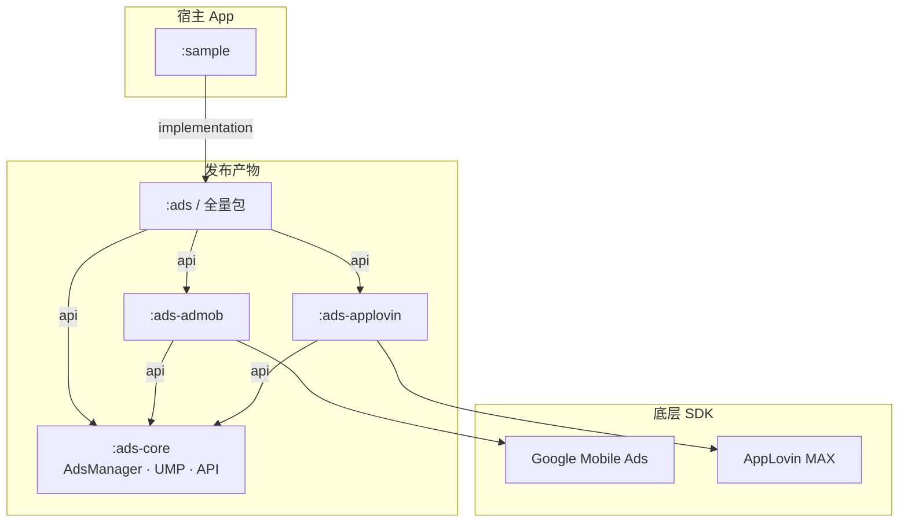
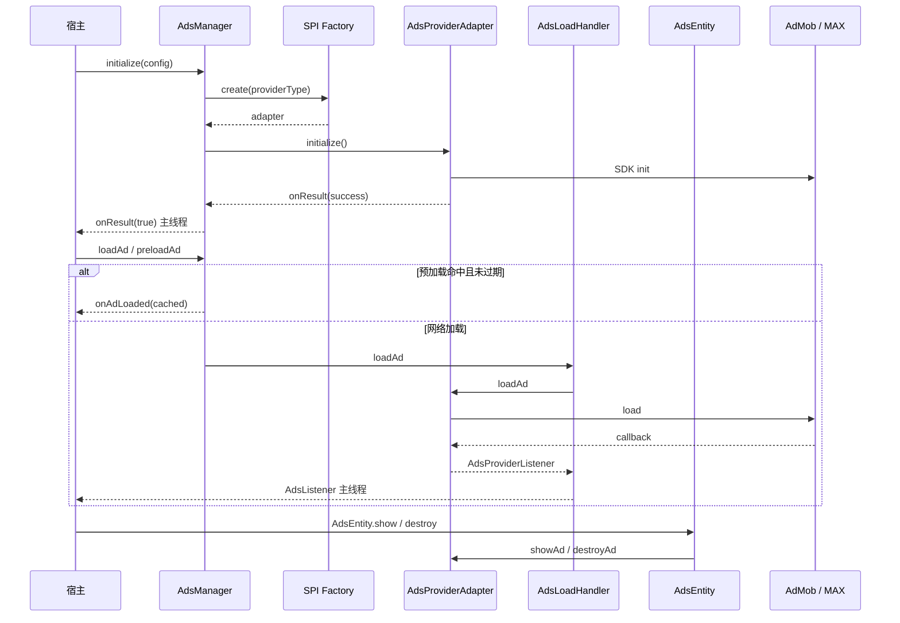
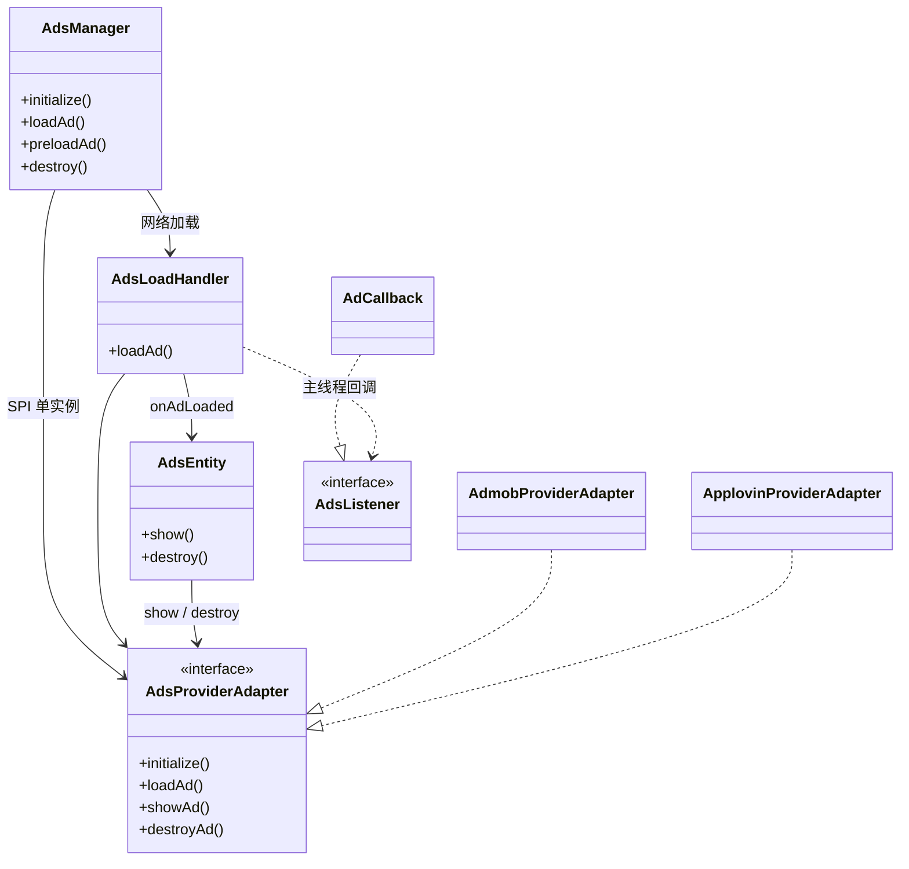

# AdsKit-Android

Android 广告聚合 SDK：统一封装 AdMob / AppLovin MAX，宿主通过单一门面 `AdsManager` 接入。

## 架构

单适配器模式：同一时刻只有一个 `AdsProviderAdapter` 生效；切换 Provider 需重新 `initialize()`（先销毁旧适配器并清空预加载缓存）。Provider 经 **Java SPI** 按 classpath 发现。

### 模块依赖



### 运行时调用链



### 核心类关系



## 接入与依赖 (GitHub Packages)

SDK 官方包统一发布于 **GitHub Packages** Maven 仓库（相比 JitPack 构建更加稳定、依赖下载迅速，直接由 GitHub Actions 官方流水线验证并发布）。

### 1. 配置仓库与认证凭据

> [!NOTE]
> GitHub Packages 要求必须通过认证（Personal Access Token）才能拉取包。

#### 步骤 1：准备 GitHub Token
前往 [GitHub Settings → Developer Settings → Personal Access Tokens](https://github.com/settings/tokens) 创建一个具有 **`read:packages`** 权限的 Token。

#### 步骤 2：配置本地凭据（全局或工程）
在用户家目录的 `~/.gradle/gradle.properties`（推荐，避免将 Token 意外提交至代码库）：
```properties
gpr.user=YOUR_GITHUB_USERNAME
gpr.key=YOUR_GITHUB_PERSONAL_ACCESS_TOKEN
```
或在 CI / 部署环境中配置系统环境变量：
```bash
export GITHUB_ACTOR="YOUR_GITHUB_USERNAME"
export GITHUB_TOKEN="YOUR_GITHUB_PERSONAL_ACCESS_TOKEN"
```

#### 步骤 3：在工程中添加 Maven 仓库

**Kotlin DSL (`settings.gradle.kts`)**：
```kotlin
dependencyResolutionManagement {
    repositoriesMode.set(RepositoriesMode.FAIL_ON_PROJECT_REPOS)
    repositories {
        google()
        mavenCentral()
        maven {
            name = "GitHubPackages"
            url = uri("https://maven.pkg.github.com/e-hai/AdsKit-Android")
            credentials {
                username = providers.gradleProperty("gpr.user").orNull ?: System.getenv("GITHUB_ACTOR") ?: ""
                password = providers.gradleProperty("gpr.key").orNull ?: System.getenv("GITHUB_TOKEN") ?: ""
            }
        }
    }
}
```

**Groovy DSL (`settings.gradle`)**：
```groovy
dependencyResolutionManagement {
    repositoriesMode.set(RepositoriesMode.FAIL_ON_PROJECT_REPOS)
    repositories {
        google()
        mavenCentral()
        maven {
            name = "GitHubPackages"
            url = uri("https://maven.pkg.github.com/e-hai/AdsKit-Android")
            credentials {
                username = providers.gradleProperty("gpr.user").orNull ?: System.getenv("GITHUB_ACTOR") ?: ""
                password = providers.gradleProperty("gpr.key").orNull ?: System.getenv("GITHUB_TOKEN") ?: ""
            }
        }
    }
}
```

### 2. 引入 SDK 依赖

根据所需广告平台按需引入：

| 产物 (Artifact) | 模块 | 说明 |
|---|---|---|
| `AdsKit` | `:ads` | **全量包**（包含 core + admob + applovin，支持运行时双平台动态切换） |
| `AdsKit-admob` | `:ads-admob` | **AdMob 瘦包**（仅集成 AdMob，传递依赖 core，大幅缩减包体积） |
| `AdsKit-applovin` | `:ads-applovin` | **AppLovin 瘦包**（仅集成 AppLovin MAX，传递依赖 core） |
| `AdsKit-core` | `:ads-core` | **核心包**（仅公共 API、`AdsManager`、UMP，适合自研适配器扩展） |

**Kotlin DSL (`app/build.gradle.kts`)**：
```kotlin
dependencies {
    // 方案 A：全量包（推荐，开箱即用）
    implementation("com.github.e-hai.AdsKit-Android:AdsKit:1.0.2")

    // 方案 B：AdMob 瘦包（仅包含 AdMob 及中介）
    // implementation("com.github.e-hai.AdsKit-Android:AdsKit-admob:1.0.2")

    // 方案 C：AppLovin 瘦包（仅包含 AppLovin MAX 及中介）
    // implementation("com.github.e-hai.AdsKit-Android:AdsKit-applovin:1.0.2")
}
```

> **💡 从 JitPack 迁移指南**：
> 1. 将 `settings.gradle.kts` 中的 `maven { url = uri("https://jitpack.io") }` 替换为上述带有鉴权的 GitHub Packages 仓库地址。
> 2. 依赖坐标格式完全统一，无需变更 group 与 artifact 命名规则。
> 3. 本地调试仍可直接通过模块引入：`implementation(project(":ads"))`。

### Sample 配置（`local.properties`）

```properties
admob.app.id=ca-app-pub-...
applovin.sdk.key=...
admob.test.device.id=...              # 可选，AdMob 测试设备哈希 ID
applovin.ad.unit.banner=...
applovin.ad.unit.rewarded=...
applovin.ad.unit.splash=...
applovin.ad.unit.interstitial=...
applovin.ad.unit.native=...
applovin.ad.unit.mrec=...
```

## 公开类型

| 类型 | 说明 |
|------|------|
| `AdsManager` | 单例门面；初始化状态机；预加载缓存（含 TTL） |
| `AdsInitState` | `IDLE` / `INITIALIZING` / `READY` / `FAILED` |
| `AdsEntity` | 已加载广告的展示句柄，`show()` / `destroy()` |
| `AdsListener` / `AdCallback` | 主线程回调 |
| `AdsPaidEvent` | 收益：`valueMicros` / `currencyCode` / `precision` |
| `AdsRequest` | `triggerId` / `adUnitId` / `adType` / `providerType` / `preloadTtlMs` |
| `AdsType` | 见下表 |
| `AdsProviderConfig` / `AdsProviderType` | Provider 配置 |
| `UMP` | Google UMP（`:ads-core`，支持可选 `umpTestDeviceIds` 参数） |

### AdsType

| 值 | 说明 | `container` |
|----|------|-------------|
| `BANNER` | 横幅 | **需要**，承载 Banner 视图 |
| `MREC` | 300×250 矩形 | **需要** |
| `NATIVE` | 原生广告 | **需要** |
| `SPLASH` | **App Open 开屏**（非普通 Splash 图） | 可传任意 `ViewGroup` |
| `INTERSTITIAL` | 插屏全屏 | 可传任意 `ViewGroup` |
| `REWARDED` | 激励视频 | 可传任意 `ViewGroup` |

> `SPLASH` 在底层对应 AdMob `AppOpenAd` / MAX `MaxAppOpenAd`。

## 核心 API

- **`initialize(app, config, logEnabled = false, debugEnabled = false, onResult?)`** — 单适配器；统一配置日志与调试开关；同 Provider 跳过 → `true`；并发 → `false`；切换清预加载；`onResult` 主线程
- **`getInitState()` / `getInitializedProviderType()`**
- **`loadAd` / `preloadAd`** — 状态与 Provider 校验；预加载默认 TTL **55 分钟**（`AdsRequest.preloadTtlMs` 可覆盖）
- **`destroy()`** — 释放适配器并清空缓存
- **`openDebug(activity)`** — AdMob Ad Inspector / MAX Mediation Debugger

Provider 通过 **Java SPI** 注册；classpath 缺少对应模块时 `initialize()` 返回 `false`。

### 推荐流程（欧盟 GDPR 合规顺序）

由于 SDK 集成了多个第三方中介适配器，为满足欧盟 GDPR / ePrivacy 隐私合规要求（在获取用户同意前不得触发三方 SDK 初始化与数据采集），**请务必先完成 `UMP.start()`，再调用 `AdsManager.initialize()`**：

```text
UMP.start() →（canRequestAds == true）→ AdsManager.initialize() → loadAd / preloadAd
```

### 回调

```
onAdStartedToLoad()
onAdLoaded(ad)
onAdFailedToLoad(error) / onAdFailedToLoad(error, errorCode?)
onAdShown() / onAdClicked() / onAdClosed()
onAdPaidEvent() / onAdPaidEvent(paid: AdsPaidEvent)
onAdUserEarnedReward()
onAdFailedToShow(error, errorCode?)
```

### 错误码

| 错误码 | 说明 |
|--------|------|
| `STATE_INITIALIZING` / `STATE_IDLE` / `STATE_FAILED` | 初始化状态不符 |
| `PROVIDER_MISMATCH` | Request 与已初始化 Provider 不一致 |
| `DISPLAY_*` | AppLovin 展示阶段错误 |
| SDK 原生码 | AdMob / AppLovin 透传 |

### 日志与调试开关

> [!IMPORTANT]
> **`logEnabled`** 与 **`debugEnabled`** 默认值均为 **`false`**，通过 `AdsManager.initialize(...)` 或 `UMP.start(...)` 传入；`AdsLogger` 与 `AdsDebug` 为 SDK 内部类（`@RestrictTo(LIBRARY_GROUP)`），不对外暴露引用。

| 参数 / 入口 | 默认值 | 作用与副作用 |
|---|---|---|
| `AdsManager.initialize(..., logEnabled)` | `false` | **纯日志开关**：控制 SDK 内部是否通过 `AdsKit-*` TAG 输出默认 Logcat 日志，无任何业务副作用。 |
| `AdsManager.initialize(..., logListener)` / `AdsManager.setLogListener(...)` | `null` | **外部日志拦截器**：非空时接管 SDK 全部日志输出（不再打印默认 Logcat），可转发至自研日志库或崩溃上报；传 `null` 恢复默认行为。 |
| `AdsManager.initialize(..., debugEnabled)` | `false` | **广告 SDK 调试开关（含副作用）**：开启后会强制将 AdMob 请求替换为测试广告位 ID、开启 AppLovin `setVerboseLogging(true)`。**仅限本地调试，严禁线上开启。** |
| `UMP.start(..., debugEnabled)` | `false` | **UMP 独立调试开关（局部变量，不关联 `AdsDebug`）**：开启后会模拟 EEA 地区并重置 UMP 隐私同意状态。 |
| `UMP.start(..., umpTestDeviceIds)` | `emptyList()` | 仅用于真机调试 UMP 强制 EEA 地区弹窗时传入的哈希测试设备 ID 列表（仅 `UMP.start` 的 `debugEnabled = true` 时生效；AdMob 常规测试设备请在 AdMob 后台配置）。 |

```kotlin
// 可选：外部拦截 SDK 日志（例如转发至自定义日志库或 Crashlytics，无需依赖内部 AdsLogger）
AdsManager.setLogListener { level, tag, message, throwable ->
    // level: AdsLogLevel.DEBUG / WARN / ERROR
    MyLogger.log(level.name, tag, message, throwable)
}
```

- 过滤 Logcat **`AdsKit`** 可看到全部 SDK 日志（子 TAG 均含此前缀）
- 常用子 TAG：`AdsKit-Admob`、`AdsKit-AppLovin`、`AdsKit-AdsLoadHandler`、`AdsKit-Sample`
- 格式统一为 `key=value`，例如：
  - 核心：`onAdLoaded id=... unit=... type=... provider=...`
  - 适配器：`loadAd` / `onAdShown` / `onAdFailedToLoad` / `showAd` / `destroyAd`
  - 生命周期：`initialize start/complete`、`destroy`、`clearPreloadedAds`、`loadAd rejected`

## 使用示例

```kotlin
// 1. 在主界面先完成 UMP 隐私同意收集，再初始化广告 SDK
UMP.start(
    activity = this,
    debugEnabled = false, // 本地测试 EEA 弹窗时可设为 BuildConfig.DEBUG
) { canRequestAds ->
    if (!canRequestAds) return@start

    AdsManager.initialize(
        context = application,
        config = AdsProviderConfig(AdsProviderType.ADMOB, "ca-app-pub-3940256099942544~3347511713"),
        logEnabled = BuildConfig.DEBUG,
        debugEnabled = false, // 本地需强制替换测试广告位时设为 BuildConfig.DEBUG
    ) { success ->
        if (!success) return@initialize

        // 2. 加载并展示广告
        val request = AdsRequest(
            triggerId = "home_banner",
            adUnitId = "ca-app-pub-3940256099942544/9214589741",
            adType = AdsType.BANNER,
            providerType = AdsProviderType.ADMOB,
        )
        AdsManager.loadAd(this, request, object : AdCallback() {
            override fun onAdLoaded(ad: AdsEntity) {
                ad.show(this@MainActivity, bannerContainer)
            }
            override fun onAdFailedToLoad(error: String, errorCode: String?) {
                Log.e("Ads", "load failed: $error ($errorCode)")
            }
            override fun onAdPaidEvent(paid: AdsPaidEvent) {
                Log.d("Ads", "revenue micros=${paid.valueMicros} ${paid.currencyCode}")
            }
            override fun onAdFailedToShow(error: String, errorCode: String?) {
                Log.e("Ads", "show failed: $error ($errorCode)")
            }
        })
    }
}

// onDestroy：Banner / Native / MREC 需 destroy
override fun onDestroy() {
    adEntity?.destroy()
    super.onDestroy()
}
```

## 构建与发布

### 本地编译与单测
```bash
./gradlew :ads-core:testDebugUnitTest
./gradlew :sample:assembleDebug
```

### 本地发布与体积校验
```bash
./gradlew publishToMavenLocal -Pgroup=com.github.ci -Pversion=test
./scripts/check-artifact-sizes.sh com.github.ci test  # AAR/APK 体积门禁校验
```

### 发布到 GitHub Packages
1. **自动发布**：打 Tag（如 `1.0.1` 或 `v1.0.1`）推送到远端，触发 `.github/workflows/publish.yml` 自动编译、测试并发布至 GitHub Packages。
2. **手动触发**：在 GitHub Actions 页面选择 `Publish to GitHub Packages` workflow，输入版本号即可手动触发。
3. **本地发布到 GitHub Packages**：
   ```bash
   ./gradlew publishReleasePublicationToGitHubPackagesRepository -Pgpr.user=e-hai -Pgpr.key=YOUR_GITHUB_TOKEN
   ```

- 版本号：统一维护在 `gradle/libs.versions.toml` → `sdkVersion`
- CI：`.github/workflows/build.yml`（PR / 主分支构建与体积校验）
- CD：`.github/workflows/publish.yml`（GitHub Packages 自动发布）

- 后台配置与上线 SOP 见 **[`docs/MEDIATION_SOP.md`](docs/MEDIATION_SOP.md)**。
- 更多实现细节、SPI、ProGuard、命名约定见 **`AGENTS.md`**。
